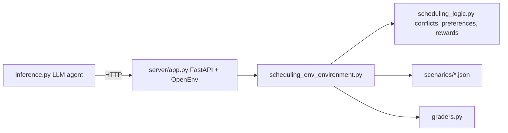

# Meeting Scheduling RL Environment (OpenEnv)

An OpenEnv-compliant reinforcement-learning environment in which an AI agent schedules a meeting across several attendees: it proposes slots, reschedules lower-priority conflicts and finalises a booking within 20 steps. Built for the Meta OpenEnv hackathon, deployable as a Hugging Face Space (Docker).

## What it does
The agent receives each attendee's existing calendar, collective working hours and personal preferences, then acts until the meeting is booked or abandoned. Episodes are graded 0.0-1.0 on scheduling quality.

## Key features
- Four actions: `propose_slot`, `reschedule_meeting`, `finalize`, `reject`.
- Three JSON scenarios of rising difficulty (`task1_easy`, `task2_medium`, `task3_hard`: 2, 4 and 6 attendees) plus a random scenario generator (`server/scenario_generator.py`).
- Shaped step rewards and a final reward penalising preference violations, rescheduling and step count; partial credit on timeout.
- Preferences modelled per attendee: preferred hours, max meetings per day, avoid back-to-back / buffer minutes.
- Programmatic graders per task (`graders.py`, `server/graders.py`) registered in `openenv.yaml`.
- FastAPI server (`/reset`, `/step`, `/state`, `/health`, `/docs`, web UI at `/web`) and an HTTP client (`client.py`).
- `inference.py`: LLM agent loop (OpenAI-compatible API, default Hugging Face router, model `Qwen/Qwen2.5-72B-Instruct`) calling the environment over HTTP, with a heuristic fallback action and `[START]/[STEP]/[END]` logging.

## Architecture


## Reward summary (from the code/README)
Step: +0.5 conflict-free proposal, +0.2 reschedulable conflicts, -0.3 non-reschedulable, -0.1 invalid action, -0.2 outside working hours. Final: `1 - preference_deduction - reschedule_deduction - 0.015*steps`, clamped to [0,1].

## Tech stack
Python 3.10+, OpenEnv core (`openenv-core`), FastAPI/Uvicorn, Pydantic, OpenAI client, requests, Docker, uv (lock file).

## Structure
```
models.py  client.py  inference.py  graders.py  openenv.yaml  pyproject.toml  Dockerfile
server/  app.py  scheduling_env_environment.py  scheduling_logic.py  graders.py
         scenario_generator.py  scenarios/task{1,2,3}_*.json
docs/    design spec and hackathon notes
```

## Run
```bash
pip install -e .                     # or: uv sync
uvicorn server.app:app --reload      # server on :8000
# LLM agent (separate shell)
export API_BASE_URL=https://router.huggingface.co/v1
export MODEL_NAME=Qwen/Qwen2.5-72B-Instruct
export HF_TOKEN=<your token>         # also accepts API_KEY; optional ENV_URL, TASK_NAME
python inference.py
```
Docker: `docker build -t scheduling_env:latest .`. Hugging Face: `openenv validate` then `openenv push`.

Note: the existing README describes `inference.py` as a no-LLM heuristic baseline, but the current code requires `HF_TOKEN` and calls an LLM (the heuristic is used only as a fallback).

## Limitations / future work
Only three hand-written scenarios plus a generator; single-meeting episodes; no tests in the repo; no published benchmark results.
